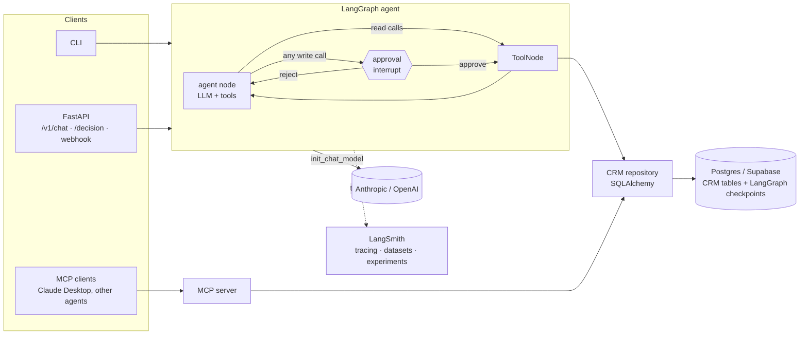

# DealDesk

[](https://github.com/adarshnandina/dealdesk/actions/workflows/ci.yml)

A model-agnostic **CRM assistant agent** built with **LangChain, LangGraph and LangSmith**.
It answers questions about a HubSpot-style CRM, drafts follow-ups, and proposes changes
(log activities, create tasks, move deal stages) that **only run after a human approves
them**. It is exposed as a CLI, a REST API with a webhook, and an MCP server, and every
run is traced and evaluated in LangSmith.

```
you > Which deals have gone quiet, and what should we do about Fjordway?

dealdesk > Three open deals have had no activity for 3+ weeks:
  • Service desk automation – Ostsee Mobility, EUR 70,000 (45 days)
  • Fleet CRM rollout – Fjordway Logistics, EUR 120,000 (35 days)
  • Loyalty agent pilot – Lindqvist Retail, EUR 55,000 (28 days)
  Fjordway is blocked on our answers to Ingrid's IT security questionnaire; the
  follow-up task is 10 days overdue. ...

you > Create a high-priority task for Jonas to send the questionnaire answers by Friday.

The agent wants to:
  - Create task 'Send IT security questionnaire answers' on deal #4, due 2026-11-06 (priority HIGH)
Approve? [y/N]: y
```

## Features

| | |
|---|---|
| **Model-agnostic LLM layer** | One factory (`init_chat_model`) for Anthropic and OpenAI (or any OpenAI-compatible endpoint, e.g. GitHub Models). Switch with one env var. |
| **Custom LangGraph agent** | Explicit `StateGraph`: agent → tools, with an **approval node** that `interrupt()`s before any write. |
| **Human-in-the-loop, durable** | Paused runs are checkpointed in **Postgres** (`PostgresSaver`), so approvals survive restarts and work across API workers. |
| **Typed tools + structured outputs** | Pydantic-validated tool inputs; `with_structured_output` for email drafts and deal summaries. |
| **MCP** | The same CRM tools as an MCP server (stdio / streamable HTTP), with read-only/write annotations. The agent can also load its tools *from* MCP. |
| **REST API + webhook** | FastAPI: chat, approve/reject, thread view, deal summary, and an HMAC-signed, idempotent `deal-stage-changed` webhook. |
| **Observability** | LangSmith tracing with provider/model tags and thread metadata on every run. |
| **Evals** | 24-example LangSmith dataset, deterministic evaluators + optional LLM-as-judge, one command to compare models. |
| **Production basics** | Postgres + SQLAlchemy 2.0 + Alembic migrations, `uv`, ruff, strict mypy, 71 tests, pre-commit, GitHub Actions, multi-stage Docker image, JSON logs. |

## Architecture



The layers have one job each: **repository** (all SQL) → **toolkit** (LLM-facing tools)
→ **graph** (control flow) → **service** (turns, approvals, tracing config) →
**interfaces** (CLI, API, MCP). Swapping the mock CRM for the real HubSpot API means
writing a new repository class; nothing above it changes.

## Quickstart

Requirements: Python 3.12+, [uv](https://docs.astral.sh/uv/), Docker.

```bash
git clone https://github.com/adarshnandina/dealdesk && cd dealdesk
cp .env.example .env          # add your API keys (see below)
make install                  # uv sync + pre-commit hooks
make up                       # Postgres in Docker, migrations, demo data
make chat                     # talk to the agent in your terminal
```

Or run the whole stack in Docker: `docker compose --profile app up --build`, then open
http://localhost:8000/docs.

### API keys

| Key | Where | Cost |
|---|---|---|
| `LANGSMITH_API_KEY` | smith.langchain.com → Settings → API Keys | Free Developer plan (5k traces/month) |
| `ANTHROPIC_API_KEY` | console.anthropic.com → API Keys | Pay-as-you-go |
| `OPENAI_API_KEY` | platform.openai.com → API keys | Pay-as-you-go |


## Usage

### CLI
```bash
uv run dealdesk chat                                   # default provider from .env
uv run dealdesk chat --provider openai --model gpt-4.1-mini
uv run dealdesk db seed                                # reset demo data
```

### REST API
```bash
uv run dealdesk serve --reload        # http://127.0.0.1:8000/docs

curl -s localhost:8000/v1/chat -H 'content-type: application/json' \
  -d '{"message": "Log a call on deal 10: Stefan received the pricing"}'
# -> {"thread_id": "...", "status": "awaiting_approval", "pending_actions": [...]}

curl -s localhost:8000/v1/threads/<thread_id>/decision -H 'content-type: application/json' \
  -d '{"decision": "approve"}'
```

| Endpoint | Purpose |
|---|---|
| `POST /v1/chat` | Run a turn (`thread_id` optional; reuse it for multi-turn memory) |
| `POST /v1/threads/{id}/decision` | Approve or reject pending writes |
| `GET /v1/threads/{id}` | Messages and pending actions of a thread |
| `POST /v1/deals/{id}/summary` | Structured deal brief (`DealSummary` JSON) |
| `POST /v1/webhooks/deal-stage-changed` | HubSpot-style event, HMAC-SHA256 signed |
| `GET /health` | Liveness + database check |

Set `DEALDESK_API_KEY` to require an `X-API-Key` header on `/v1` endpoints.

**Webhook flow:** a signed event syncs the new stage into the database and starts an
agent run in thread `webhook-deal-<id>-<event_id>`. Any task the agent proposes waits for
approval in that thread. Repeated deliveries of the same event are ignored (idempotent).

```bash
body='{"event_id":"evt-1","deal_id":8,"new_stage":"closedwon","occurred_at":"2026-11-04T10:00:00Z"}'
sig="sha256=$(printf '%s' "$body" | openssl dgst -sha256 -hmac "$DEALDESK_WEBHOOK_SECRET" | cut -d' ' -f2)"
curl -s localhost:8000/v1/webhooks/deal-stage-changed -H "x-dealdesk-signature: $sig" \
  -H 'content-type: application/json' -d "$body"
```

### MCP
```bash
uv run dealdesk mcp                    # stdio
uv run dealdesk mcp --transport http   # streamable HTTP on :8001/mcp
uv run python examples/mcp_agent.py "Which deals are stale?"   # agent using MCP tools
```
Claude Desktop config (`claude_desktop_config.json`):
```json
{"mcpServers": {"dealdesk": {"command": "uv", "args": ["--directory", "/path/to/dealdesk", "run", "dealdesk", "mcp"]}}}
```

## Observability with LangSmith

With `LANGSMITH_TRACING=true`, every turn is one trace (`dealdesk_turn`) containing the
graph nodes, each LLM call (prompt, tool calls, token usage, latency, cost) and each tool
call with its input and output. Runs are tagged with the provider, the model and the
entry point (`api`, `cli`, `webhook`, `eval`, `decision:approve`), and carry
`thread_id` metadata, so you can filter for one conversation or compare models side by
side.

## Evals

`evals/` contains a 24-example dataset across lookups, aggregates, multi-hop questions,
grounding (questions the data cannot answer), writes and drafts. Answers are checkable
because the seed data is hand-written.

| Evaluator | Type | Checks |
|---|---|---|
| `correct_facts` | deterministic | Required facts and EUR amounts appear in the answer (format-insensitive) |
| `tool_selection` | deterministic | A suitable tool was called for each required step |
| `approval_behavior` | deterministic | Writes pause with the right tool and arguments; reads never propose writes |
| `llm_judge` | LLM-as-judge (optional) | Answer agrees with the reference and invents nothing |

```bash
# Compare models in LangSmith (dataset is created on first run)
uv run python -m evals.run \
  --model anthropic:claude-haiku-5-5 \
  --model openai:gpt-4.1-mini \
  --judge anthropic:claude-sonnet-5-5

uv run python -m evals.run --model anthropic --offline     # no upload
```

Each model becomes a LangSmith experiment on the same dataset (use the *Compare* view),
and a summary table is appended to `evals/results/results.md`:

| Model | Correct facts | Tool selection | Approval behaviour | LLM judge | Avg latency (s) | p95 latency (s) | Avg tokens |
|---|---|---|---|---|---|---|---|
| _run `make eval` to fill this in_ | | | | | | | |

The test suite also checks the eval set itself: every reference answer must pass its own
checks, and every expected write must target the right seeded deal.

## Project structure

```
src/dealdesk/
  config.py            settings from env (.env), twelve-factor style
  logging_config.py    console or JSON logs
  db/                  SQLAlchemy models, session, hand-written seed data
  crm/                 repository (all SQL) + Pydantic DTOs
  llm/                 model-agnostic chat model factory
  agent/               tools, prompts, structured outputs, graph, service
  api/                 FastAPI app and schemas
  mcp_server.py        MCP server over the same tools
  cli.py               `dealdesk` command
migrations/            Alembic migrations
evals/                 dataset, evaluators, runner
tests/                 71 tests: Postgres-backed, scripted fake LLM, no API cost
docs/DECISIONS.md      design decisions and trade-offs
```

## Development

```bash
make check          # ruff + mypy (strict) + pytest
```
Tests run against a real Postgres (`dealdesk_test`, created by docker compose) and a
scripted fake chat model, so they are deterministic and free. They cover the repository,
tools, graph routing (approve, reject, mixed batches, memory, restart recovery with the
Postgres checkpointer), the API (auth, webhook signature and idempotency), MCP over
stdio, and the eval suite.
